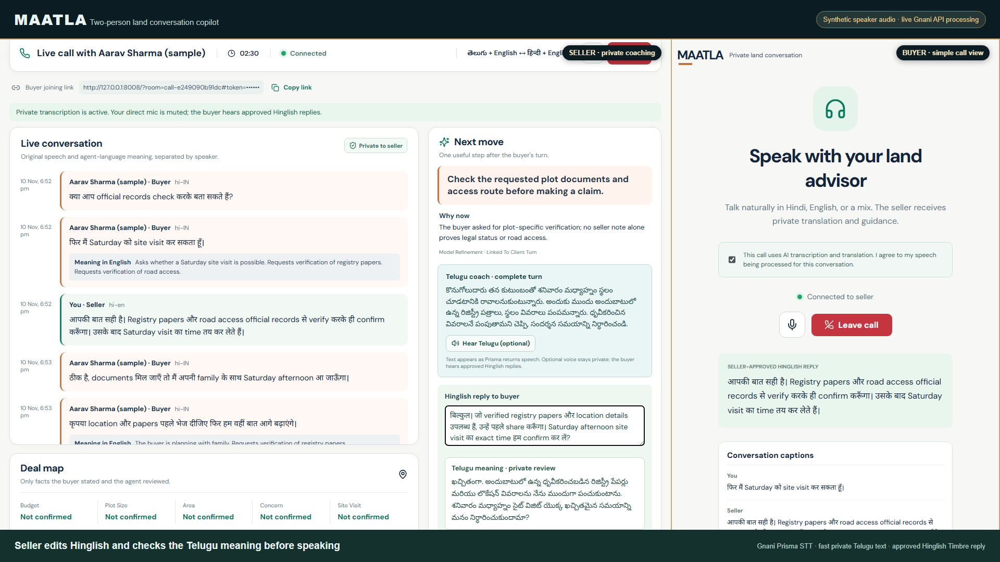
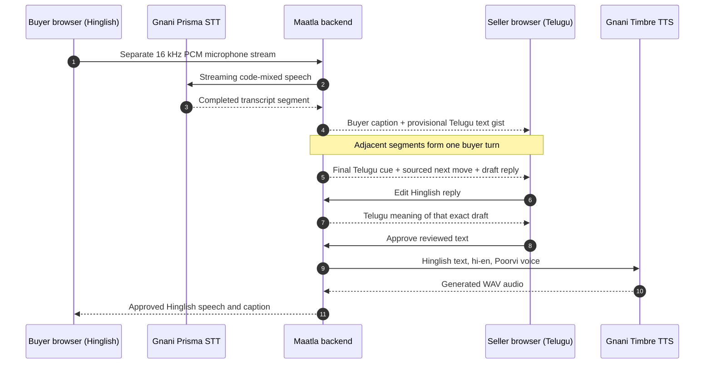
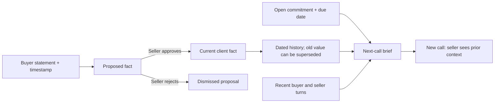
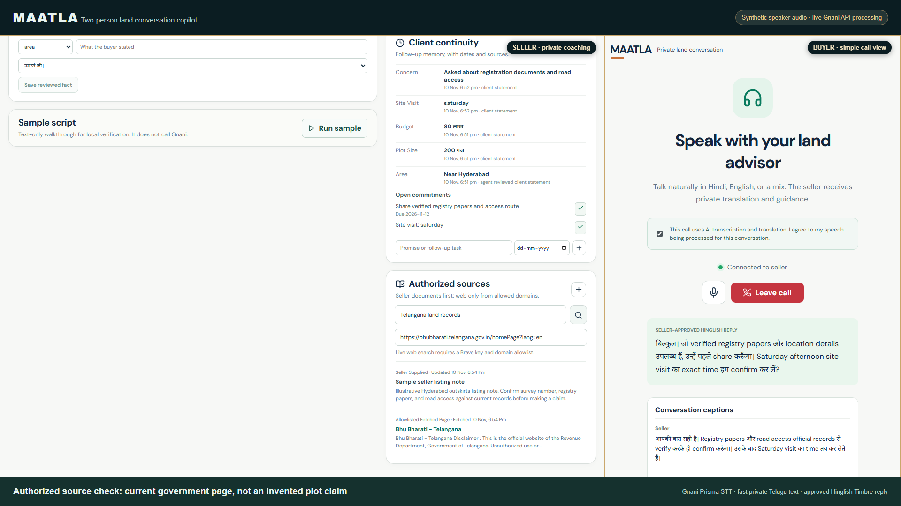
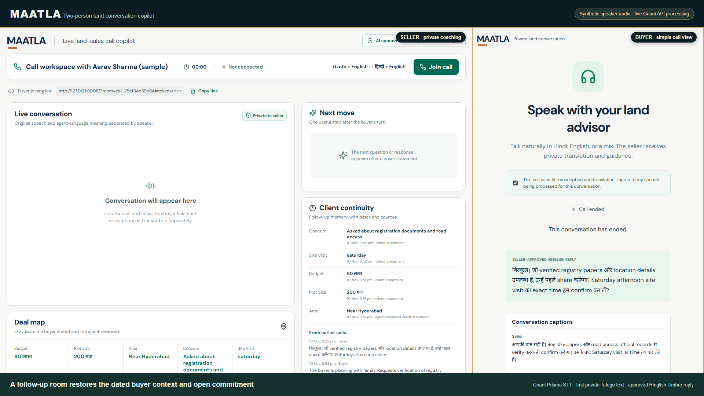
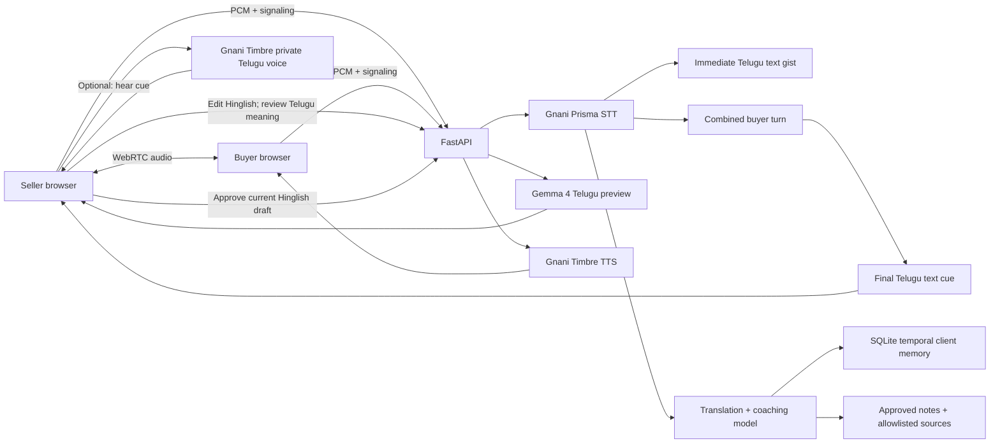

# Maatla


*Illustrative banner artwork. The people and land documents shown are fictional.*

**A live, two-person browser call copilot for a Telugu-English land seller and a Hinglish buyer.** The call remains between the two people. Maatla listens to their separate microphones and shows speaker-labelled captions. A private Telugu text gist appears as soon as Prisma returns a buyer speech segment; a complete turn cue and next move follow after the buyer pauses. The seller edits a Hinglish reply, reviews its freshly translated Telugu meaning, and approves it before Gnani Timbre speaks the Hinglish text to the buyer. Telugu coach audio is available only on demand.

[Watch the 43-second highlight](docs/demo/Maatla-fast-text-60s.mp4) · [Watch the full 3-minute-23-second walkthrough](docs/demo/Maatla-fast-text-full.mp4) · [One-page submission brief (PDF)](docs/Maatla-submission-one-page.pdf)

## Project explanation for the Gnani AI challenge

### Title, problem, and target users

**Maatla — a private, live, cross-language sales copilot for real-estate conversations.** A Telugu-speaking land seller in Telangana or Andhra Pradesh can meet a buyer who is more comfortable in Hindi-English. In a time-sensitive call, the seller must understand budget, plot size, intended use, document questions, and next steps without losing the buyer's exact meaning. The buyer needs a natural Hinglish response. Both people need confidence that property-specific claims are checked rather than invented.

The primary user is the **human seller or advisor** handling land enquiries; the second user is the **buyer** on the other side of the same browser call. Maatla augments that conversation. It does not autonomously negotiate, declare a plot legally clear, or infer a buyer's personality from language or accent. The seller remains responsible for the response and any deal decision.

### What the working application does

1. The seller creates a private call for a client. The buyer opens a separate link, consents to AI speech processing, and joins. The browser call has two distinct audio streams and speaker-labelled captions.
2. The Hinglish-speaking buyer talks naturally. **Gnani Prisma** transcribes their code-mixed speech. Each returned segment immediately produces a **provisional Telugu text gist** in the seller's private pane. A completed-turn cue follows after adjacent segments are grouped.
3. A reasoning layer combines the current buyer turn with dated client facts, earlier turns, open commitments, and approved knowledge. It proposes one next move and a Hinglish reply. This layer is local Ollama by default; it is **not Gnani Evon**.
4. The seller edits the Hinglish response. The application translates **that exact edited text** into Telugu underneath it. Any subsequent edit invalidates the prior translation and blocks approval until a new preview is ready.
5. After the seller approves, **Gnani Timbre** synthesizes the Hinglish response and the buyer hears it. The private Telugu cue stays on the seller side; Telugu voice can be requested manually and is never part of the default buyer audio.
6. The seller can check approved knowledge or fetch a current page from an allowlisted official domain, review proposed buyer facts, and record a sourced promise. After the call, a new room for the same buyer restores dated context and open commitments.

**Why this matters:** the interface addresses the entire decision loop, not only speech translation. It helps the seller hear accurately, identify the immediate next question, avoid unsupported land claims, respond in the buyer's language, and carry forward the buyer's requirements into the next conversation. It is designed to improve the quality and continuity of a human-led sales meeting; no closing-rate improvement is claimed without field evaluation.

### The two-sided experience



*Actual application capture from a synthetic two-speaker run. The buyer audio was fed through the live Gnani Prisma API; the seller-approved Hinglish audio came from Gnani Timbre. The displayed buyer and land enquiry are examples.*



### How Gnani AI is used in the core path

| Gnani capability | Implementation in Maatla | Why the API is essential |
| --- | --- | --- |
| **Prisma v3 streaming speech to text** | Each person has a separate server-side Prisma WebSocket session. The browser audio worklet sends 16 kHz, mono, 16-bit PCM in 1,024-byte frames. The buyer session hints `hi-IN`, the seller session `te-IN`, and Prisma v3 uses `format=codemix`. Transcript events retain speaker identity and detected language. | Without live code-mixed transcription, the private Telugu cue, seller next move, captions, and source-linked memory have no reliable spoken input. A text-only sample control is explicitly labelled and is not presented as Prisma output. |
| **Timbre v2.5 text to speech** | The server sends only a seller-approved Hinglish draft to Timbre's inference endpoint with `language=hi-en`, `voice=Poorvi`, and 24 kHz WAV output. The returned audio is delivered to the buyer call view with the matching caption. | It converts a reviewed cross-language response into audible buyer-facing speech. Approval and a current Telugu meaning are required before the request is made. |
| **Optional private Telugu Timbre voice** | When the seller presses **Hear Telugu**, the server calls Timbre with `language=te-IN`, `voice=Varuni`. The result is returned only to the seller. | It offers accessibility without adding TTS delay to the normal private coaching path or playing the coach to the buyer. |

Prisma and Timbre calls are made from the backend, where the API key stays. The Telugu quick gist is a deliberately provisional text interpretation of a Prisma segment, while the final cue uses the grouped turn. Local Ollama/Qwen provides structured turn reasoning and Gemma supplies the exact-draft Telugu preview; neither is described as a Gnani model. The application can use an OpenAI-compatible reasoning endpoint through configuration, but the recorded build used the local default.

### Design decisions that make the workflow usable

- **Two views and two trust boundaries:** the buyer sees consent, connection status, their speech captions, and the approved response. The seller sees private coaching, facts, sources, and prior-call context. Room tokens gate access to each view; the buyer cannot request the seller's brief or suggestion state.
- **Fast cue before complete reasoning:** a segment-level Telugu text gist arrives with a Prisma transcript, while slower turn grouping and model refinement run separately. The quiet window is 9 seconds in this build so a pause after a greeting does not prematurely split a buyer turn. The seller can act on the provisional cue but should treat it as updating until the complete cue appears.
- **No automatic cross-language voice overlap:** the seller's outgoing mic begins muted in AI reply mode; the buyer-facing Timbre response is sent only after seller approval. The seller can intentionally unmute for direct speech. The recorded demo schedules synthetic buyer turns and approved voice replies without overlap.
- **Review before persistence or speech:** proposed buyer facts do not become current client facts until the seller approves them. The exact Hinglish reply and its Telugu meaning are tied together by a preview ID, so an unreviewed edit cannot be spoken.
- **Source-aware land advice:** a seller note is labelled as seller-supplied. Local knowledge retrieval checks approval and expiry. Live fetching accepts only configured HTTPS domains and records the page title, URL, and fetch time. Finding an official page does not prove a particular plot's title, access, price, or availability.

### Client continuity, evidence, and follow-up



This is a compact **temporal retrieval** design backed by SQLite: current facts, historical values with validity intervals, recent utterances, and open commitments are retrieved for the next turn and next room. It is not a vector-search database or an autonomous CRM. The application keeps the original statement and timestamps so the seller can see what was said and when. The post-call summary is extractive and distinguishes confirmed facts from pending proposals.





### Recorded verification and current limits

The synthetic two-speaker browser recording exercised **three Hinglish buyer turns**, **eight Prisma speech segments**, **three completed Telugu text cues**, **three seller-reviewed Telugu reply previews**, and **three approved Timbre Hinglish audio replies** with no provider errors. In that run the first provisional cue for each buyer turn appeared **before the buyer finished speaking**. Seller speech started after each buyer turn ended, with no buyer/seller voice overlap. Backend tests: **9 passed**; frontend production build: **passed**. These are observations from one same-computer demo, not population-level speech accuracy or network latency benchmarks.

The current prototype is served locally. A remote deployment needs HTTPS/WSS, configured TURN, account-level access controls, retention and consent policies, and two-device testing with human Telugu/Hinglish speakers and noisy telephony conditions. The deterministic Telugu gist handles common enquiry patterns and may be incomplete for arbitrary buyer speech; the complete turn cue and seller review remain important. Brave search requires a separate key; the recorded demo used direct fetching of an allowlisted official page. No title or registration clearance for a specific property was verified.

### Contribution and provenance

The applicant supplied the product concept, scenario, language direction, feature requirements, and review feedback. The implementation and demo preparation were AI-assisted with Codex. The final registrant should state their own and any teammate's actual roles in the challenge form. The sample buyer, audio, and listing are synthetic.

## What is in the build

| Capability | Implementation |
| --- | --- |
| Two-person call | WebRTC carries the buyer's live microphone to the seller. The seller's outgoing microphone starts muted in AI reply mode; the seller can deliberately unmute for direct speech. WebSocket signaling and optional TURN support calls across networks. |
| Code-mixed speech | Gnani Prisma streaming STT, 16 kHz PCM frames, `format=codemix`; seller stream hints Telugu, buyer stream hints Hindi. |
| Translation | Buyer speech receives an English meaning for the seller after a completed segment. The seller reviews a Telugu meaning of the exact Hinglish draft before its buyer-facing caption and voice are sent. Direct seller speech can be heard over WebRTC when deliberately unmuted; that path is not a translated buyer-caption feature in this prototype. |
| Fast Telugu coaching | A provisional Telugu text gist appears with each Prisma buyer segment. Adjacent segments are combined after 9 seconds of quiet for one final Telugu text cue and refined next move. The seller can request optional private Telugu audio, but automatic TTS does not delay the text path. |
| Client continuity | SQLite stores dated, source-linked facts, prior turns, approved spoken Hinglish replies, open commitments, and superseded fact history. The model receives a compact temporal context. Proposed facts require seller review; the seller can also save a detail tied to a buyer statement. |
| Deal map | Budget, area, plot size, concern, and site visit; unconfirmed fields stay unconfirmed. |
| Sources | Seller-supplied notes are labelled as such. Local search works offline. Allowed HTTPS pages can be fetched live. Brave web search is optional and restricted to configured domains. |
| Reviewed reply | Seller edits mixed Hindi-English text. A Telugu translation of that exact draft appears underneath; an edit invalidates the previous preview and speaking is disabled until the new preview is ready. Gnani Timbre `hi-en` sends only the approved Hinglish reply to the buyer. Plot-specific document and access questions remain verification-first. |
| Post-call | Extractive summary, reviewed buyer requirements, concerns, commitments, and unresolved fact proposals. |

No property title, registration status, approval, or availability is treated as verified from a sales note or AI output. The included buyer and plot are **synthetic examples**.

## Run locally (Windows PowerShell)

Prerequisites: Python 3.12+, Node.js 20+, and [Ollama](https://ollama.com/download). From the project root:

```powershell
Copy-Item backend\.env.example backend\.env
# Edit backend\.env: set GNANI_API_KEY and a long random MAATLA_AGENT_ACCESS_KEY.
# Keep this file private. It is ignored by git.
ollama pull qwen2.5:3b
ollama pull gemma4:latest
py -3.12 -m venv backend\.venv
backend\.venv\Scripts\python -m pip install -r backend\requirements.txt
npm ci --prefix frontend
npm run build --prefix frontend
backend\.venv\Scripts\python -m uvicorn app.main:app --app-dir backend --host 127.0.0.1 --port 8008 --no-access-log
```

After setup, `./start-local.ps1` runs the same local server and checks for missing configuration.

Open **http://127.0.0.1:8008** and enter `MAATLA_AGENT_ACCESS_KEY`. Select the sample client or add one, create a call, then open the buyer link in another browser window. The buyer checks the AI processing consent box before joining. Both sides need microphone access for a live call. The “Run sample” button is a synthetic text-only walkthrough; it does **not** exercise Gnani STT.

For frontend development, run `npm run dev --prefix frontend` and open `http://127.0.0.1:5173`. Set `MAATLA_FRONTEND_ORIGIN` to that exact origin. The production build is served by FastAPI on port 8008; its API uses the same origin.

## Configure real calls and sources

- `GNANI_API_KEY` is required for live STT, private Telugu-English coach TTS, and approved Hinglish reply TTS. Credentials stay on the backend.
- `MAATLA_LLM_PROVIDER=ollama`, `OLLAMA_MODEL=qwen2.5:3b` for turn reasoning, and `MAATLA_TRANSLATION_MODEL=gemma4:latest` for the edited-reply Telugu preview are the local defaults. The translation model is a large download. For hosted inference, set `MAATLA_LLM_PROVIDER=openai_compatible`, `MAATLA_LLM_URL`, `MAATLA_LLM_MODEL`, and `MAATLA_LLM_API_KEY`.
- `MAATLA_ALLOWED_DOMAINS` is the seller-approved list of HTTPS source domains. The example lists Telangana and Andhra Pradesh government portals. `BRAVE_SEARCH_API_KEY` enables domain-restricted live search; direct allowed-URL fetching works without it.
- For people on different networks, serve the app over **HTTPS/WSS** and configure `MAATLA_TURN_URL`, `MAATLA_TURN_USERNAME`, and `MAATLA_TURN_CREDENTIAL`. STUN alone cannot guarantee a connection across all networks. Share the public HTTPS buyer link, not a `127.0.0.1` link.
- Keep the server's SQLite database and `.env` private and backed up before using real client information. The agent access key protects the client list and room creation; room-specific tokens protect call data. Tokens are kept in URL fragments and sent to the API in headers or as the first WebSocket message. This is a prototype, not a multi-user account or compliance system.

The challenge account rejected a comma-separated `language_code` even though the [Prisma streaming documentation](https://docs.gnani.ai/api/STT/stt-websocket) describes multiple language hints. This build uses one locale per speaker and the documented `codemix` format. For voice, [Timbre's voice list](https://docs.gnani.ai/api/TTS/available-voices) includes `Poorvi` (`hi-en`) for the buyer-facing Hinglish reply and `Varuni` (`te-IN`) for optional private Telugu audio; it does not list a dedicated Telugu-English locale. Test natural code-mixed speech and voice quality with both speakers before a live deployment.

The local Qwen 3B model is a prototype reasoning layer. For the common buyer phrases in the demo, grounded Telugu coach templates preserve the buyer's request and avoid unverified property claims. Gemma 4 translates the exact edited Hinglish draft to Telugu for seller review; if that preview fails, the app blocks speech approval. Arbitrary mixed-language translation needs broader speaker testing before production use.

## Verification

```powershell
cd backend
python -m pytest -q
python provider_smoke.py   # real Gnani call; needs backend\.env
python provider_smoke.py --mixed  # synthetic Hinglish TTS-to-STT sample
cd ..\frontend
npm run build
```

The tests cover temporal fact history, role isolation, synthetic input labelling, review-gated facts, unit normalization, fast Telugu gist delivery, and two-person signaling. The recorded same-computer browser run feeds a synthetic Hinglish buyer track through Gnani Prisma; the seller's outgoing microphone is muted. Three buyer turns produce provisional Telugu text and one complete cue each. The seller edits and reviews three Hinglish replies, each with a fresh Telugu meaning, before Timbre sends the approved voices to the buyer. The recording mixes the synthetic buyer microphone and actual returned Timbre audio after the screen capture, with no raw seller Telugu speech in the buyer channel. This establishes an API-backed synthetic-audio demo, not live human speech accuracy or a remote-device call. Live microphones, TURN-assisted remote audio, wider Telugu-English speech, and end-to-end latency still need a two-device field test. The text-only **Run sample** control does not call Gnani.

## Architecture



See [Gnani's STT](https://docs.gnani.ai/api/STT/stt-websocket), [Prisma v3](https://docs.gnani.ai/api/STT/models/prisma-v3), and [TTS](https://docs.gnani.ai/api/TTS/tts-inference) documentation for the provider interfaces. The government URLs in `.env.example` are source locations, not evidence that a particular plot has clear title.
